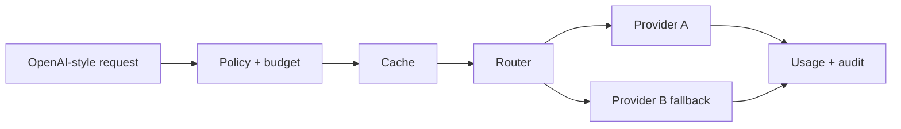

# LLM Gateway Control Plane

[](https://github.com/ZhengjunSun/llm-gateway-control-plane/actions/workflows/ci.yml)

A provider-neutral routing core for enterprise LLM traffic. It demonstrates model aliases, budget enforcement, rate limiting, semantic-safe caching, circuit breakers, fallback, usage accounting and redacted audit logs.



## Features

- Stable model aliases decoupled from providers
- Ordered fallback with per-provider circuit breakers
- Per-tenant request and spend budgets
- Deterministic response cache excluding secrets
- Token/cost accounting and structured audit events
- Mock providers for offline tests; adapter protocol for real SDKs

```bash
python -m llm_gateway.demo
python -m unittest discover -s tests -v
```

This repository contains no API credentials and does not proxy real traffic by default.

## Prior art

The design is informed by public gateway patterns in LiteLLM, Envoy and cloud API management products. The implementation is original and intentionally compact.

## License

MIT
